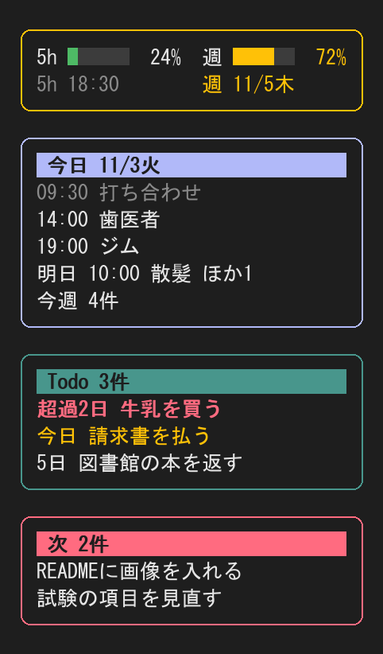

# vault-panel

Claude Code の右側に、使用量、Google カレンダーの予定、Obsidian Vault の Todo、次にやることを常時表示するペインです。区画ごとに色の帯と丸枠で見分けられ、縦の長さに合わせて表示を詰めます。

A Claude Code side pane that shows your rate-limit usage, today's Google Calendar events, and the Todos in your Obsidian vault, framed and colored per section. The labels are in Japanese.

## 表示



（架空のデータで描いた例です。実際の色は端末のテーマに合わせて変わります）

- 使用量：5時間と週の枠を横棒で1行に。その下の行に回復の時刻（5時間枠は時刻、週の枠は日付）をいつも出す。70%で黄、90%で赤になる（枠の色も変わる）
- 予定：今日（終わった予定は薄く）、明日、今週の件数
- Todo：〆切の近い順。超過は赤、今日〆切は黄。入りきらない分は「ほか N件」
- 次（赤）：作業記録の最新の見出しにある未完了の項目

`/panel` でペインを開き直して最新にし、次にやることを全部出します。読み取り専用で、予定や Todo を変更しません。

## 入れ方

Claude Code の入力欄で：

```
/plugin install vault-panel --marketplace R76H94/claude-vault-panel
```

シェルから：

```
claude plugin install vault-panel --marketplace R76H94/claude-vault-panel
```

デスクトップアプリでは、入力欄の横の + から Plugins、Add marketplace で `R76H94/claude-vault-panel` を追加し、Add plugin を選びます。

## 設定

入れるときに聞かれます。あとから `/config` でも変えられます。

| 項目 | 内容 | 既定 |
|---|---|---|
| `vaultPath` | Vault のフォルダの絶対パス（必須） | なし |
| `todoDir` | Todo のフォルダ（Vault 内）。直下の `.md` 1件が Todo 1件 | `todo` |
| `worklogFile` | 「次」に出す作業記録のファイル（Vault 内）。空なら出さない | 空 |
| `diaryDir` | `YYYY/MM/YYYY-MM-DD.md` の日記のフォルダ。`## 振り返り` がなければ起動時に知らせる。空なら知らせない | 空 |
| `diaryScript` | 1日の最初の起動で `python` で実行するスクリプト（Vault 内）。空なら実行しない | 空 |
| `calendarServer` | Google Calendar のコネクタ名 | `claude.ai Google Calendar` |

Todo のファイルはフロントマターに `title`、`status`（`完了` と `中止` は表示しない）、`due`（`YYYY-MM-DD`）、`priority`（`高`、`中`、`低`）を持ちます。

```markdown
---
title: 牛乳を買う
status: 未着手
due: 2026-11-05
priority: 中
---
```

予定を出すには、Claude の Google Calendar コネクタを接続してください。時刻は日本時間で表示します。

## ライセンス

MIT
